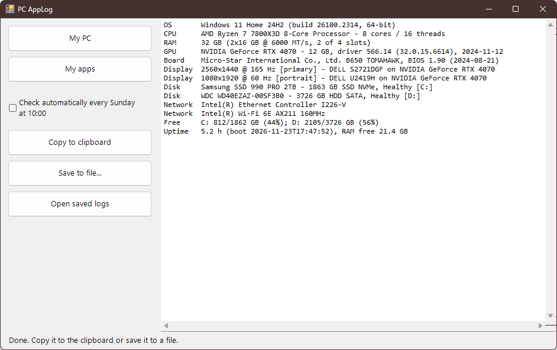
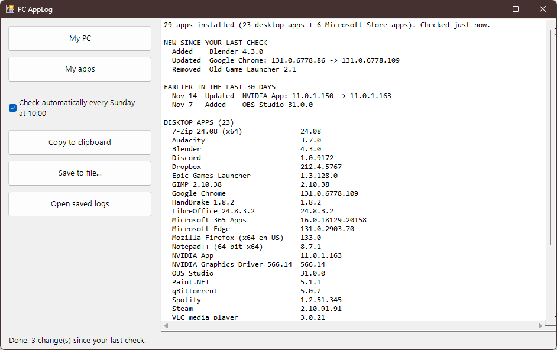

# PC AppLog

**See what is inside your PC and what changed on it. One click. Nothing to install.**

A small, free tool for Windows 10 and 11. Double-click **Start**, press a button, and you get:

- **My PC**: your full specs in one short list, ready to paste into a support chat, an email or a forum post. It starts with **Worth knowing**: plain-language notes on anything that deserves a look, like a nearly full drive.
- **My apps**: everything installed on the PC, plus what was added, removed or updated recently.

Copy the result with one click, or save it as a text file, a Markdown note, a spreadsheet or JSON.



<sub>The screenshots on this page show made-up sample data.</sub>

## Download and start

### [Download PC AppLog (ZIP)](https://github.com/KiyViz/Personal-PC-AppLog/releases/latest/download/Personal-PC-AppLog.zip)

1. Click the link above. The file `Personal-PC-AppLog.zip` lands in your Downloads folder.
2. Right-click the ZIP and choose **Extract All**.
3. Open the new folder and double-click **Start** (it may show as `Start.bat`).

That is the whole setup. There is no installer, no account and no admin password prompt.

**If Windows shows a warning the first time** ("Windows protected your PC" or "Open File - Security Warning"), that is Windows being careful with any file downloaded from the internet. Choose **More info > Run anyway**, or **Run**. See [Is it safe?](#is-it-safe) below for exactly what the tool does.

## When is it useful?

| Situation | What you do |
|---|---|
| Someone asks **"what are your specs?"** in a support chat, forum or Discord | Press **My PC**, then **Copy to clipboard**, and paste. |
| Your PC **feels slow or something seems off** | Press **My PC** and read the **Worth knowing** notes at the top. |
| **Something broke** and you wonder what changed | Press **My apps** to see what was installed, removed or updated lately. |
| You are asking an **AI assistant** for help with your PC, an upgrade or whether a game will run | Paste the **My PC** list so it works from facts, not guesses. |
| You are thinking about an **upgrade** | **My PC** shows free memory slots, your graphics card and driver, and disk space and health. |
| You are about to **reinstall Windows or move to a new PC** | **My apps** is the list of everything to install again. |
| You help a **family member or friend** with their PC | Ask them to press one button and send you the result. |
| You want to notice **apps that appeared without you asking** | Tick the weekly check, and look at **My apps** now and then. |
| You want the list in a **spreadsheet, your notes or another program** | Press **Save to file** and pick the type. |

## What it looks like

**My PC** starts with **Worth knowing**. It only speaks up when something deserves a look, and says so when nothing does. It checks for:

- a drive that is nearly full, or a disk that reports a health problem
- memory running slower than it was sold for
- a display set to a lower refresh rate than it can do
- a missing or very old graphics driver
- a wired network connection stuck at a slow speed
- a long time without a restart, very little memory, or Windows 10 being out of support

Notes marked `!` are worth acting on soon. Notes marked `-` are good to know.

**My apps** shows one page: what changed since your last check, what changed in the last 30 days, and the full list.



| Button | What it does |
|---|---|
| **My PC** | Your hardware and Windows version in one short list, with notes on anything worth a look. |
| **My apps** | Everything installed, plus what was added, removed or updated. |
| **Check automatically every Sunday at 10:00** | Tick it and the check runs by itself once a week. Untick it to stop. |
| **Copy to clipboard** | Copies what is on screen so you can paste it anywhere. |
| **Save to file...** | Saves what is on screen as a file. You pick the type (see below). |
| **Open saved logs** | Opens the folder where results are kept. |

### File types for Save to file

| Type | Good for |
|---|---|
| Plain text (`.txt`) | Email, printing, or anywhere that just needs words. Same as what you see on screen. |
| Markdown (`.md`) | Notes apps, GitHub, Reddit and other places that turn Markdown into neat tables. |
| Spreadsheet (`.csv`) | Excel, Google Sheets or LibreOffice. One row per part or per app, so you can sort and filter. |
| JSON (`.json`) | Other programs and scripts. |

## Is it safe?

Short answer: it only looks, it does not touch.

| Question | Answer |
|---|---|
| Does it install anything? | No. It runs from the folder you unzipped. |
| Does it need an admin password? | No. |
| Does it change my settings, apps or files? | No. It reads information and writes its results into a `logs` folder next to **Start**. |
| Does it send anything over the internet? | No. It makes no network connections. Your results stay on your PC until you paste them somewhere yourself. |
| Does it collect personal details? | The specs list has no serial numbers, no network (MAC) addresses, no computer name and no user name. Your app list is personal, so read it before you share it. |
| Does it keep running in the background? | No. When you close the window, it is gone. The one exception is the weekly check, and only if you tick that box. |
| What does the weekly check add? | One entry in Windows Task Scheduler named `Personal-PC-AppLog`. Unticking the box removes it. |
| Can I see what it does? | Yes. It is a handful of plain-text scripts in the `app` folder that anyone can open and read. It is open source under the MIT license. |
| Is it tested? | Yes. An automatic test runs on every change: [](https://github.com/KiyViz/Personal-PC-AppLog/actions/workflows/test.yml) |

## Remove it

1. Open **Start** and untick the weekly check, if you turned it on.
2. Delete the folder.

Nothing else is left behind.

## Questions

**How fast does it open?**
About one second on the PC it was built on. The very first start after downloading takes a little longer.

**Where are my results?**
In the `logs` folder next to **Start**. The **Open saved logs** button takes you there.

**The first time I pressed My apps it said there was nothing to compare. Why?**
The first check saves a starting point. From the second check on, it shows what changed.

**Why are some apps listed with odd names like `Microsoft.WindowsCalculator`?**
Apps from the Microsoft Store are recorded under their package name. They are listed in their own section.

**Does it show temperatures or run benchmarks?**
No. It is a quick summary and a change log. For sensors and stress tests, tools like HWiNFO do that well.

**Does it work on Windows 10?**
Yes, Windows 10 and 11. It uses the PowerShell that is already part of Windows.

**Something looks wrong or is missing.**
Please [open an issue](https://github.com/KiyViz/Personal-PC-AppLog/issues) and say what you expected to see.

## For advanced users

<details>
<summary>Terminal menu, command line, JSON and AI assistants</summary>

### What is in the folder

```
Start.bat        opens the window
app\             the scripts (plain text, PowerShell 5.1)
  PCSpecs.ps1      hardware and OS specs
  AppLog.ps1       installed apps and what changed
  Schedule.ps1     adds or removes the weekly Task Scheduler task
  Launcher.ps1     the window that Start.bat opens
  Menu.bat         the same tools as a numbered keyboard menu
logs\            created on first use; your results
AGENTS.md        notes and schemas for AI assistants
```

### Keyboard menu

Double-click `app\Menu.bat` for a numbered menu in a terminal instead of the window.

### Command line

```powershell
.\app\PCSpecs.ps1 -Copy           # summary + copy to clipboard
.\app\PCSpecs.ps1 -NoSave         # print only, write nothing
.\app\AppLog.ps1                  # snapshot + show changes
.\app\AppLog.ps1 -History 30      # changes in the last 30 days (writes nothing)
.\app\AppLog.ps1 -All             # include hidden components (runtimes, sub-installers)
.\app\AppLog.ps1 -NoStore         # skip Microsoft Store apps
.\app\Schedule.ps1 -Every Daily -At 09:30
.\app\Schedule.ps1 -Remove
```

`PCSpecs.ps1` and `AppLog.ps1` also take `-Json` (machine-readable output) and `-LogDir <path>` (save logs somewhere else). Run `Get-Help .\app\AppLog.ps1 -Full` for details.

If PowerShell says running scripts is disabled:

```powershell
powershell -ExecutionPolicy Bypass -File .\app\PCSpecs.ps1
```

### With an AI assistant

See [AGENTS.md](AGENTS.md) for the JSON schemas and diagnosis hints. Short version: run `.\app\PCSpecs.ps1 -Json -NoSave` and `.\app\AppLog.ps1 -History 30 -Json`, then paste the output or let your agent run them.

### Without downloading anything

`PCSpecs.ps1` and `AppLog.ps1` each work on their own. Open one on GitHub, copy all of its text, paste it into a **Windows PowerShell** window and press Enter. Results are saved in a `logs` folder inside the folder the window is in. Read the code first; that is the point of it being plain text.

### Saved files

```
logs\
  runs.jsonl                   one line per run (ok / error)
  apps\
    latest.json                current app list
    changes.jsonl              added / removed / updated, one event per line
    snapshots\<date>.json      full list at each change
  specs\
    latest.json                full specs ("spec" = stable, "live" = uptime, free space...)
    latest.txt                 plain-text summary
    changes.jsonl              field-level spec changes (for example a GPU driver update)
    history\<date>.json        full specs at each change
```

JSON, UTF-8, no BOM. Snapshots are written only when something changed, so the folder stays small.

### Tests and screenshots

`tests\Smoke.ps1` runs both tools into a temporary folder and checks the output (exit codes, JSON, no false changes), then opens the window off-screen and presses each button. It runs on every push. `tests\Make-Screenshots.ps1` regenerates the pictures on this page from sample data. `tests\Measure-Startup.ps1` times how long the window takes to appear (the budget is under one second). Neither folder is in the download ZIP.

</details>

## License

[MIT](LICENSE). Free to use, copy and change.
